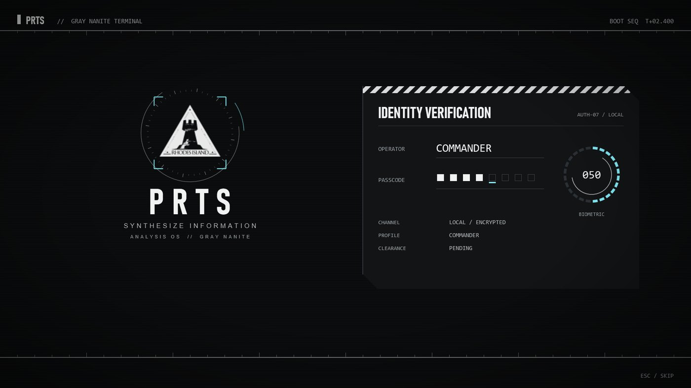
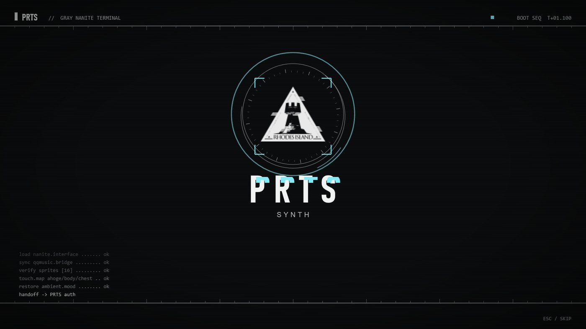
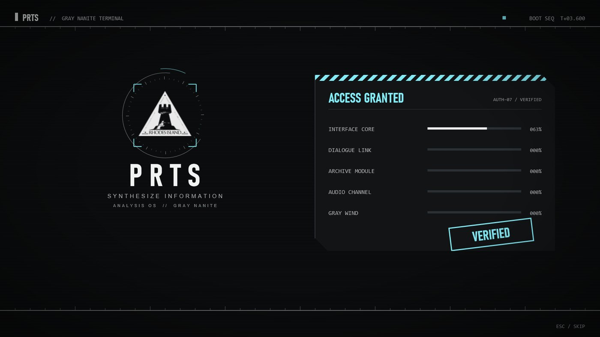
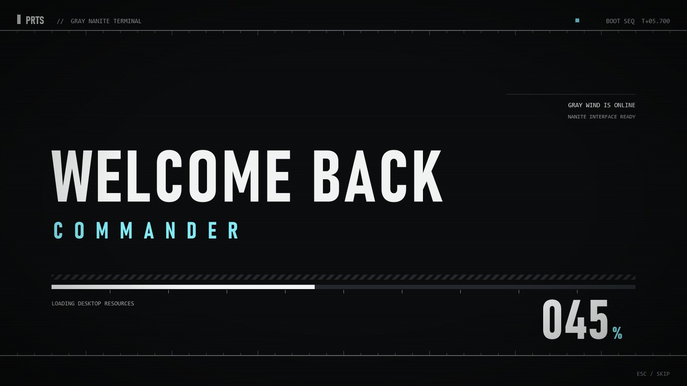
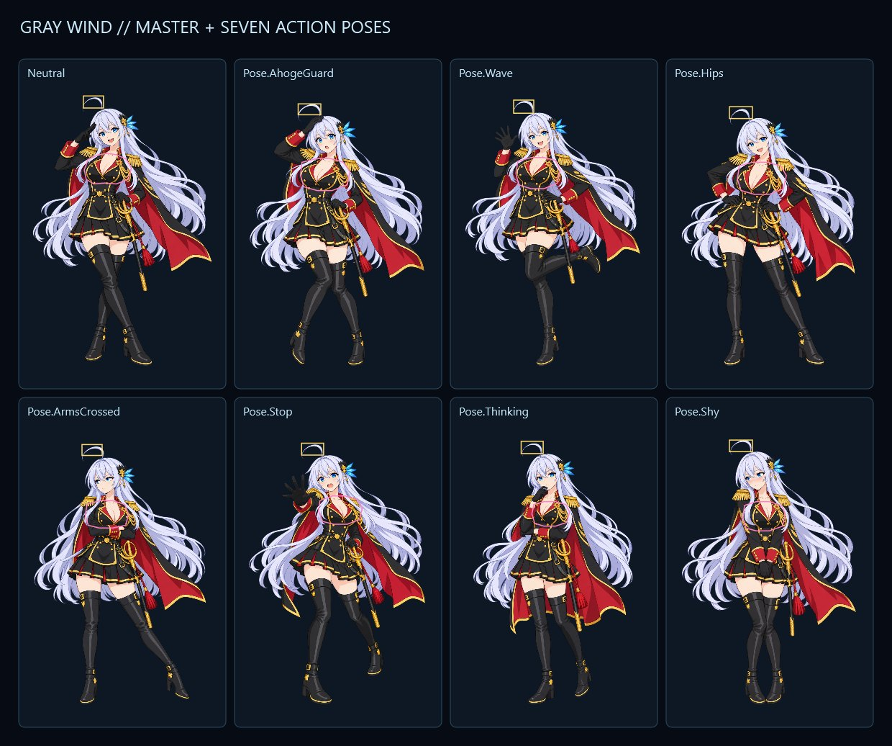
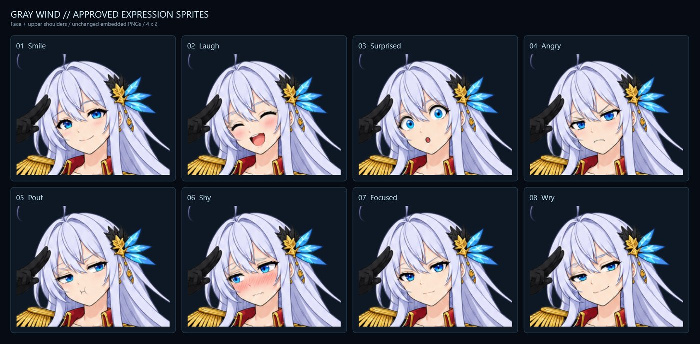

# Gray Nanite Desktop · 灰风互动桌面

一款 Windows 互动桌面，风格参照明日方舟 PRTS 终端。看板娘是"灰风"：银灰长发、头顶呆毛、一身军礼服。她站在桌面中央，点她会说话、换表情、摆动作。桌面同时整合了文件夹整理、AI 对话、QQ 音乐控制、系统监控和天气。

*A Windows WPF interactive desktop in the style of Arknights' PRTS terminal, starring the character Gray Wind. Chinese UI.*



## 功能一览

### PRTS 开场动画
- 每次开机都会播一段约 9 秒的终端开场，配英文开机语音。
- 流程依次是：罗德岛徽记扫描显形、PRTS 字样解码、身份验证（逐位输入密码、生物识别环）、ACCESS GRANTED 盖章、WELCOME BACK COMMANDER，最后一道斜切刀光划开开场，露出真正的桌面。
- 开场会等你在 Windows 登录界面输完密码、进入桌面后才开始，不会在锁屏时空播。
- 中途锁屏再解锁，会重新播放一遍。
- 按 Esc 跳过开场。Windows 关闭动画效果时，开场也会自动减弱动效。
- 支持 16:9、笔记本、带鱼屏和竖屏。

| 徽记显形 | 验证通过 | 欢迎回来 |
|---|---|---|
|  |  |  |

### 看板娘·灰风
- 全身立绘为动画截图风格的赛璐璐上色，带呼吸、轻微摆动、全息投影底座、扫描线和信号干扰等效果。
- **点击互动：** 点呆毛、身体或胸口这三个区域，各有三段语音轮换。对话框会同时显示中英文台词。
- **8 种表情：** 微笑、大笑、惊讶、生气、鼓嘴、害羞、专注、苦笑。
- **7 个全身动作：** 护呆毛、挥手、叉腰、抱臂、"停"、思考、害羞捂胸。动作是全身重画的，腿也会跟着动。
- **切换方式：** 换表情或动作时会交叉淡入淡出；换动作时还会轻轻上浮再落下，看起来像她真的动了一下。语音结束后反应会多停留一会儿，再慢慢回到默认的敬礼姿势。
- **随对话变化：** 聊天中开心时她会微笑，分析问题时摆思考动作，警报时摆"停"的动作。
- **精确命中：** 点击判定只看人物不透明的像素，透明区域点了没反应。每个动作都单独测量过点击区域。





### 指挥界面（文件整理）
- 左侧有 8 个分类入口：战术模拟库（游戏）、全息媒体库、智械研究部（AI）、外交通讯站（社交）、工程工具舱、历史数据库、学术研究区，以及"未分类信号"待整理区。
- 每个分类在 `BIND FOLDERS` 里绑定到你自己的文件夹，可以绑定到其他磁盘。
- 右侧文件面板支持浏览、搜索、打开文件，还能把文件归类移动到别的分类。程序不会覆盖已有文件；打开可执行文件前会先问你。
- 显示回收站占用，以及指定磁盘的容量。

### 与灰风对话（AI）
- 在对话框里给灰风下指令。后台调用本机的 Codex CLI，沿用你自己的 Codex 登录和权限设置，程序本身不保存任何 API 密钥。
- 她能在你绑定的文件夹里新建文件夹、文本文件或 Word 文档，也能打开文件。所有操作都限制在绑定目录内，会拒绝借符号链接跳出目录。
- 回复会带上情绪状态，驱动她的表情和动作。

### QQ 音乐坞
- 底部是音乐条，显示歌名、进度和播放模式，可以播放、暂停、切歌、拖动进度、调音量，还有实时输出音量条。
- 可以绑定一个 QQ 音乐歌单或专辑的分享链接，开机后自动打开并开始播放，然后把 QQ 音乐收进系统托盘。
- 只读取 QQ 音乐客户端公开的媒体会话，不读账号、Cookie 或私人文件。

### 系统面板
- 实时显示 CPU 占用、NVIDIA 显卡占用和显存（需要装有 `nvidia-smi`）、网络上下行速度和时钟。
- 按 IP 定位显示天气，离线时不影响其他功能。

### 桌面行为
- 程序贴在普通窗口下面当作桌面，不占任务栏。
- 按 F10 或点托盘图标可以显示或隐藏。
- 开机自启动默认关闭，需要在 `BIND FOLDERS` 里手动打开。

## 安装与构建

需要 Windows 10/11 x64 和 .NET 10 SDK。

```powershell
powershell.exe -NoProfile -ExecutionPolicy Bypass -File .\Build.ps1
# 或者直接：
dotnet publish .\StellarisUI.csproj -c Release -r win-x64 --self-contained true -p:PublishSingleFile=true -p:IncludeNativeLibrariesForSelfExtract=true
```

产物是一个单文件 `StellarisUI.exe`，旁边还有语音、脚本等外置资源。不熟悉命令行的话，可以照 [FRIEND-SETUP-GUIDE.md](FRIEND-SETUP-GUIDE.md) 把整段提示词交给 ChatGPT 或 Codex 代为安装。AI 对话功能需要本机已安装并登录 Codex CLI。

## 诊断命令

下面这些命令都不会创建主窗口，也不会改开机自启动、文件夹绑定或音乐设置，适合在改代码后自检：

| 命令 | 作用 |
|---|---|
| `--self-test` | 校验语音、徽记、开场时间轴、全部立绘、点击区域和语音映射 |
| `--intro-render-test=<目录>` | 离屏渲染开场各阶段截图 |
| `--expression-render-test=<目录> --character-layout-source=<XAML>` | 导出表情与动作对照图，并检查每套立绘在 4 种屏幕尺寸下的布局 |
| `--character-render-test=<目录> --character-layout-source=<XAML>` | 检查人物布局和点击区域 |
| `--desktop-gate-probe=<秒>` | 每秒记录一次"现在是否已进入桌面"，用来排查锁屏检测 |
| `--skip-intro` | 正常启动但跳过开场（会照常应用自启动设置） |

## 目录结构

- `StellarisUI.MainWindow.xaml`：界面布局。
- `StellarisUI/MainWindow.cs`：桌面主逻辑，包括文件、对话、音乐、动画、锁屏重播。
- `StellarisUI/StartupBootOverlay.cs`：PRTS 开场动画。
- `StellarisUI/CharacterPose.cs`、`CharacterExpressionAssets.cs`、`CharacterVoiceInteraction.cs`：表情、动作、点击区域和语音。
- `StellarisUI/QQMusic*.cs`、`Tools/QQMusicBridge.ps1`：QQ 音乐联动。
- `Assets/`：立绘（嵌入程序）、开场语音、互动语音和徽记。
- `docs/`：本说明里用到的截图，都是程序离屏渲染的诊断图。
- [WORK-NOTES.md](WORK-NOTES.md)：开发与部署记录。

## 说明

这是个人非商业的同人项目。"明日方舟"、"罗德岛"、PRTS 等名称和徽记归其权利方所有。灰风的立绘和语音是为本项目单独制作的。
